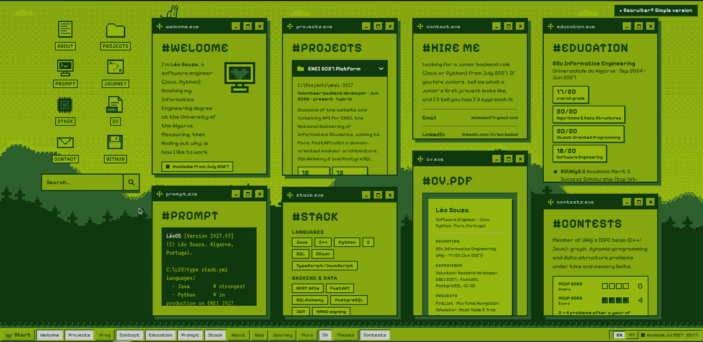
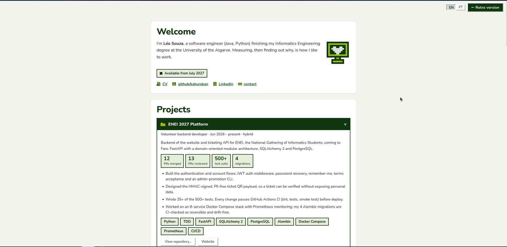

# kakurokan.github.io

Personal portfolio of **Léo Souza**, software engineer (Java, Python), finishing a BSc in Informatics Engineering at the University of the Algarve and available from **July 2027**.

**Live:** https://kakurokan.github.io · Portuguese: https://kakurokan.github.io/?lang=pt

The site is a retro desktop. Cards work like windows: you can drag one onto another to swap them, minimize, expand or close them, and reopen any of them from the taskbar. A small pixel-art cat, Koji, walks across the cards, jumps between them and naps now and then.





## Features

- **Projects, contests, education and stack** in draggable cards. Only the most relevant ones are open on load.
- **Simple version for recruiters:** the "Recruiter? Simple version" button (top right, always visible) swaps the desktop for a plain single-column page. Link straight to it with `?simple`, e.g. `https://kakurokan.github.io/?simple`.
- **English / Portuguese**, switchable from the taskbar or with `?lang=pt` in the URL.
- **Five themes:** Game Boy (default, with an animated pixel-art wallpaper drawn on a canvas), vaporwave, pink, mint and night.
- **Search** across every card, including closed ones, accent-insensitive.
- **Direct link to a project:** `https://kakurokan.github.io/#enei-2027` opens the Projects card on that project. Opening a project puts its link in the address bar.
- **GitHub activity:** a contribution graph and the latest public commits, fetched from public APIs (no token) and cached for 30 minutes. If a request fails, that part simply does not show.
- **Command prompt** with `HELP`, `DIR`, `TYPE stack.yml`, `START projects`, `THEME vapor`, `LANG pt`, `GIT LOG` and `NEOFETCH`.
- **Accessible and lightweight:** real buttons and links, keyboard support, `prefers-reduced-motion` respected, and no build step or dependencies.

## Stack

Plain HTML, CSS and JavaScript (native ES modules). There is no framework, no bundler and no build step, so GitHub Pages serves the files as they are. Fonts come from Google Fonts. Every icon and the wallpaper is pixel art defined in code.

```
index.html          markup, with the English text already inside (see "Editing content")
css/                one file per concern: themes, base, scene, layout, cards, cat, taskbar, responsive, simple
js/
  main.js           startup: wires the modules together
  state.js          shared state + a tiny event bus (on / emit)
  store.js util.js  localStorage wrapper, small helpers
  i18n/             en.js, pt.js, index.js (t / tr). Portuguese is only downloaded when needed
  data/             projects.js, terminal.js
  ui/               cards, layout, taskbar, search, tags, themes, startmenu, lang, mode, terminal, clock
  fx/               icons.js, wallpaper.js, cat.js, loader.js. Wallpaper and cat load on demand
tools/prerender.mjs writes the English text into index.html
```

Modules never call each other to ask for a redraw. They emit an event (`refresh`, `layout`, `tasks`, `goto`, `lang`…) and whoever cares listens to it. The list is in `js/state.js`.

## Run locally

ES modules do not work from `file://`, so serve the folder:

```bash
python3 -m http.server 8000
# http://localhost:8000
```

## Editing content

| What | Where |
| --- | --- |
| All text, in English and Portuguese | `js/i18n/en.js`, `js/i18n/pt.js` |
| Projects (description, stats, tags, links) | `PROJECTS` in `js/data/projects.js` |
| Compact "More projects" list | `MORE` in `js/data/projects.js` |
| Prompt command texts | `js/data/terminal.js` |
| Card order and which cards start closed | `DEFAULT_ORDER`, `DEFAULT_CLOSED` in `js/state.js` |
| CV file per language | `cv.file` in `js/i18n/*.js` (`cv-en.pdf`) |

The English text is also written into `index.html` so search engines, link previews and visitors without JavaScript see content. After changing text or projects, run:

```bash
node tools/prerender.mjs
```

Browsers cache files for a few minutes on GitHub Pages. If a visitor (or you) still sees an old script right after a deploy, a hard refresh fixes it.

## Tests

```bash
npm test
```

Runs with Node's built-in test runner (no dependencies). The tests check that both languages have the same keys, that every key used in `index.html` exists, that every card has a name and a place in the default order, the HTML generated for the projects, and that the prerendered `index.html` is up to date. GitHub Actions runs them on every push (`.github/workflows/test.yml`).

## Deploy

GitHub Pages serves the `main` branch from the repository root. Pushing to `main` updates the site in about a minute.

## Contact

[LinkedIn](https://www.linkedin.com/in/leo-kakali) · [GitHub](https://github.com/kakurokan) · leokakali7@gmail.com

© 2026 Léo Souza
